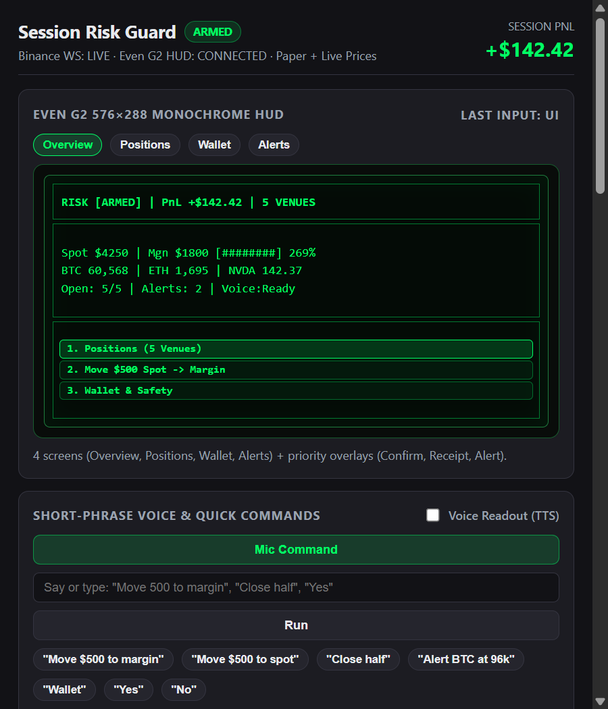

# Session Risk Guard

**Even Realities G2 Smart Glasses + Even R1 Ring · Track 03: Exchanges & Stocks**

A glanceable, hands-free **read-and-write trading & risk guard** for the **Even Realities G2** (`576×288` monochrome HUD). It monitors live crypto (`BTCUSDT`, `ETHUSDT`, `SOLUSDT` via Binance WebSocket) and equity positions (`NVDA`, `SPY` for Interactive Brokers) across **Binance · OKX · Bybit · Coinbase · Interactive Brokers**, surfaces real-time session PnL, margin health, drawdown alerts, and price alerts, and lets traders execute **confirmed quick actions** via 1-tap, Ring scroll, or short voice phrases.

---

## Screenshots (Even Hub Simulator `576×288`)

| Overview (`PORTFOLIO`) | Positions (`POSITIONS`) |
| :---: | :---: |
|  |  |

| `Yes / No` Confirmation (`CONFIRM`) | Execution Receipt (`RECEIPT`) |
| :---: | :---: |
|  |  |

**Companion Dashboard & Live `576×288` G2 Mirror:**



---

## Track 03 & Judging Criteria Coverage

- **Usefulness on G2 · 30%:** Glanceable multi-venue PnL, Spot/Margin collateral & ASCII health bar (`[######--]`), automatic `-1.8%` drawdown alerts, custom price alerts, and hands-free Ring scroll (`SCROLL_TOP_EVENT` / `SCROLL_BOTTOM_EVENT`) + Temple tap navigation across **4 screens** (`Overview`, `Positions`, `Wallet & Safety`, `Price Alerts`).
- **Read & Write Speed · 25%:** Short-phrase voice/intent parser with smart defaults (`"Move 500 to margin"`, `"Move 500 to spot"`, `"Close half"`, `"Move stop to entry"`, `"Alert BTC at 96k"`, `"Wallet"`, `"Yes"`, `"No"`, `"Status"`) plus 1-tap HUD actions.
- **Confirmation Flow (`Yes / No`):** Displays `"Move $500 from Spot to Margin?"`, `"Close 50% ..."`, or `"Move ... Stop -> Entry?"` with projected Spot/Margin balances & Margin Health and `[ YES - Confirm & Execute ]` / `[ NO - Cancel ]` directly on the glasses.
- **Technical Execution · 20%:** Modular TypeScript + Vite + `@evenrealities/even_hub_sdk` with serialized/throttled `textContainerUpgrade()` updates, `rebuildPageContainer()` on screen/overlay switches, pure-ASCII LVGL-safe formatting, and optional HMAC-SHA256 Binance Futures Testnet order signing.
- **UX for `576×288` Display & Voice · 15%:** Strict 3-container HUD (`44px` header `<= 56` chars, `116px` 3-line body `<= 56` chars/line, `120px` action list `1–4` items) + Web Speech API voice input, optional TTS readout, and `audioControl()` G2 mic hook.
- **Business Potential & Safety · 10%:** Mandatory `Yes / No` confirmation gate before money/order actions, `$1,000` max single-transfer cap, `-$1,500` daily loss limit alert, Paper Exchange default, and strictly ephemeral RAM-only API keys (never written to `localStorage`).

---

## 30-Second Hackathon Judge Demo Flow

1. Start the dev server and launch the Even Hub Simulator (`npm run dev` + `npm run simulate`), then interact directly inside the **Even Hub Simulator's built-in companion pane** below the glasses display (so companion actions and the G2 lenses share the same live session).
2. **4-Screen G2 HUD:** Tap `1. Positions (5 Venues)` on the glasses (or click **Overview / Positions / Wallet / Alerts** tabs) and cycle across **Binance**, **Bybit**, **OKX**, **Coinbase**, and **Interactive Brokers (`NVDA`)**.
3. **Price & Drawdown Alerts:** Click **Trigger -2.5% Flash Dip** (or **Trigger Price Alert**) to surface an immediate `ALERT` overlay on the `576×288` HUD and watch Margin Health drop.
4. **Quick Action `Yes / No` Confirmation:** Tap `Move $500 Spot -> Margin` on the alert (or type/speak `"Move 500 to margin"`) to open `CONFIRM ACTION` showing projected balances & health (`>> Move $500 from Spot to Margin?`).
5. **Confirm Hands-Free & Safety Cap:** Tap **1. YES - Confirm & Execute** (or say `"Yes"`) to view the `[OK] Moved $500 Spot -> Margin` receipt. Try `"Move 2000 to margin"` to see `[X] SAFETY BLOCKED` enforce the `$1,000` transfer cap.

---

## Commands

```bash
npm install      # Install dependencies
npm test         # Run automated unit & HUD layout invariant tests (8 suites)
npm run build    # TypeScript check + production Vite build (dist/)
npm run dev      # Start local Vite dev server on http://localhost:5173
npm run simulate # Launch Even Hub Simulator against http://localhost:5173
npm run pack     # Build & stamp Even Hub package (out.ehpk)
```
